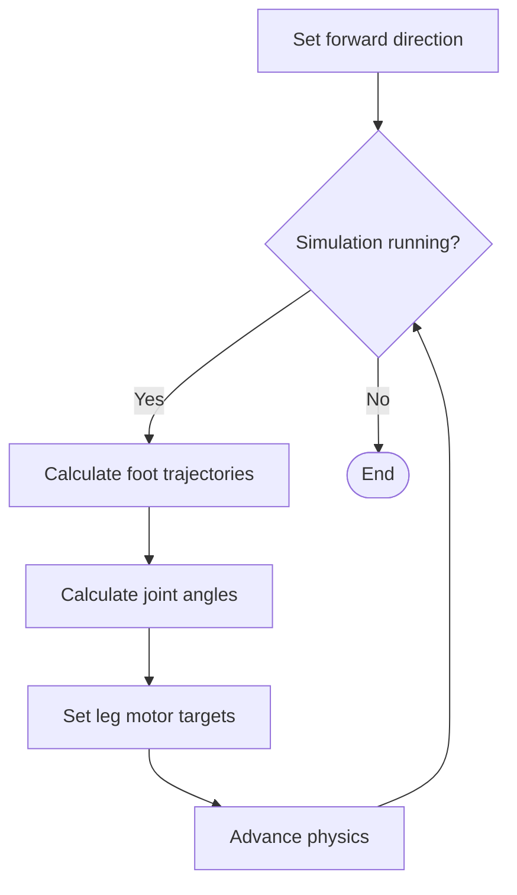

# Forward Gait Flow Diagram

Click a block to open the corresponding method call on GitHub. This diagram shows continuous forward walking while the Up arrow is held; initialization and keyboard callback details are omitted.

For a closer look at the gait, run the scripts in [gait_visualization](../workspace/gait_visualization/) to inspect the Matplotlib graphs of the forward gait, leg forward kinematics, and leg inverse kinematics.
