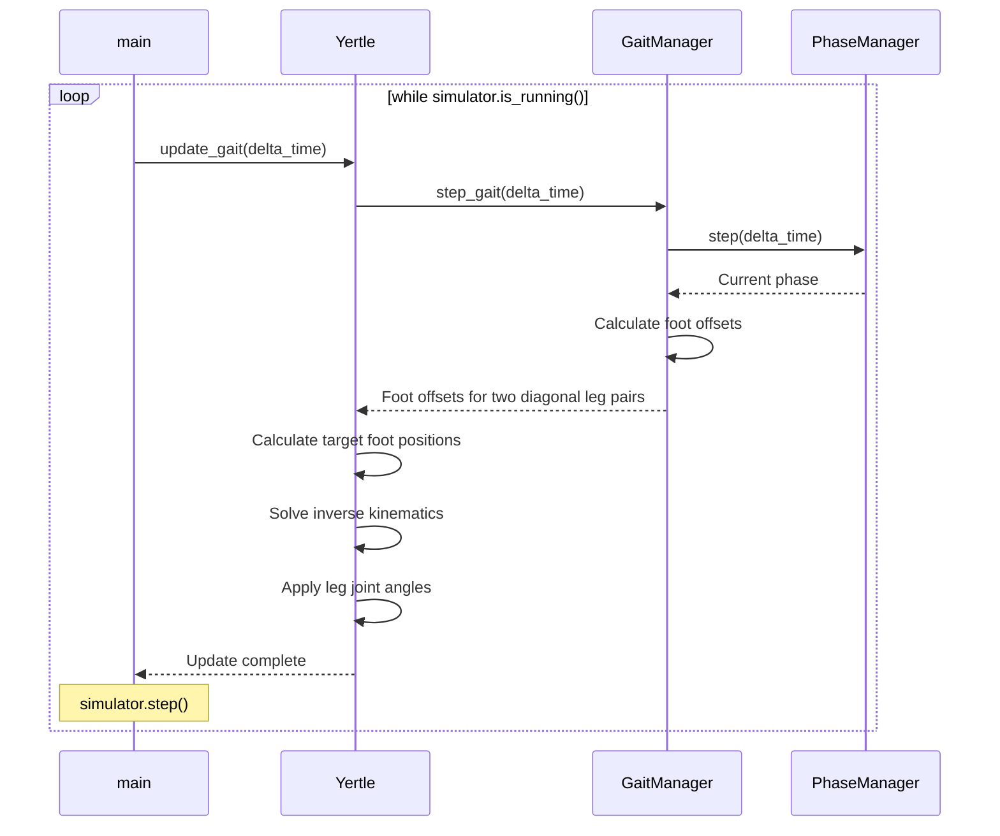

# Gait Flow Sequence Diagram

Forward walking during one iteration of the main simulation loop.

`delta_time = 1.0 / simulator.fps`. While stopped, `update_gait()` returns immediately; the gait calculations above run only while walking.
