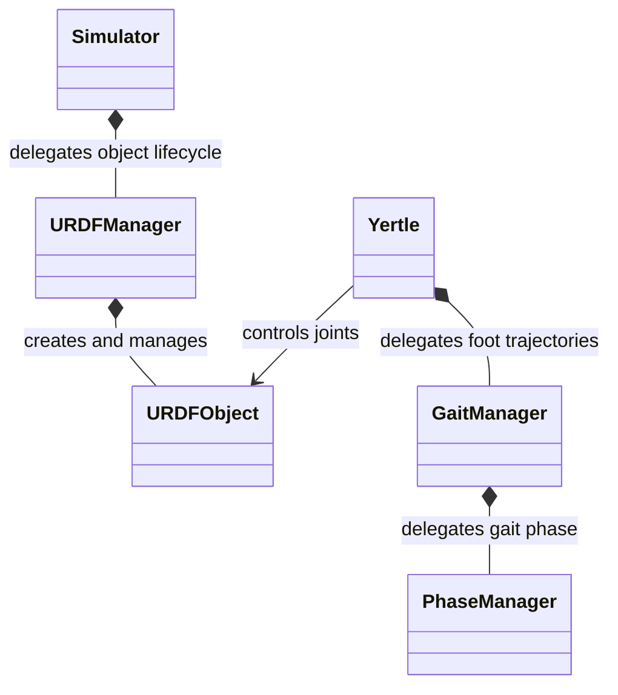
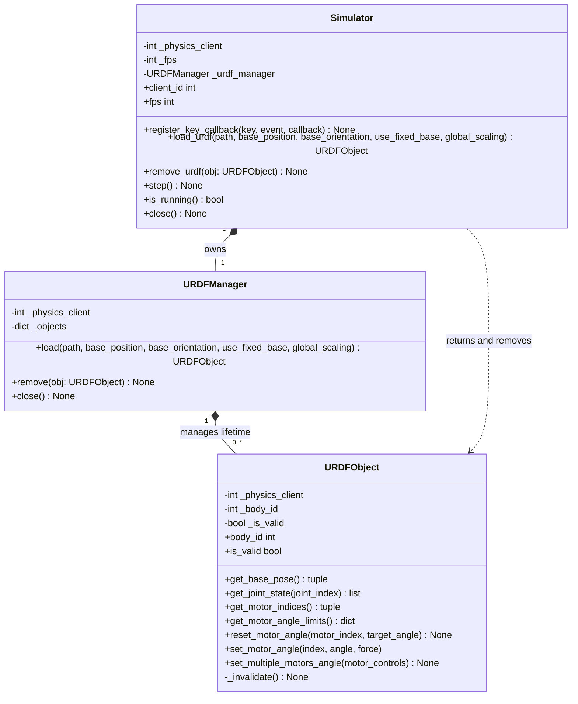
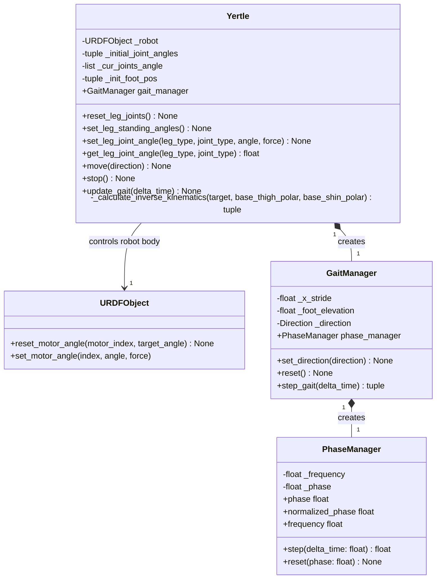

# Simulator Class Diagrams

These diagrams describe the classes in `workspace/simulator/`, starting with the overall structure and then expanding the PyBullet and robot gait layers.

## 1. Summarized Simulator Class Diagram

`*--` indicates creation and lifecycle ownership; `-->` indicates an object reference. There is no inheritance between these classes. `Yertle` controls a supplied `URDFObject`, whose lifecycle belongs to `URDFManager`.

| Class | Responsibility |
| --- | --- |
| [Simulator](workspace/simulator/simulator.py) | PyBullet connection, keyboard input, physics stepping, and shutdown |
| [URDFManager](workspace/simulator/urdf_manager.py) | URDF loading, removal, and handle invalidation |
| [URDFObject](workspace/simulator/urdf_object.py) | Body pose and joint inspection, and motor control |
| [Yertle](workspace/simulator/yertle.py) | Standing pose, inverse kinematics, and leg joint control |
| [GaitManager](workspace/simulator/gait_manager.py) | Foot trajectories for the two diagonal leg pairs |
| [PhaseManager](workspace/simulator/phase_manager.py) | Gait phase progression from frequency and elapsed time |

## 2. PyBullet Simulator Class Diagram

The PyBullet API is wrapped at three levels: `Simulator` manages the physics world, `URDFManager` manages the bodies within that world, and `URDFObject` provides access to an individual body.

Only selected members are shown in the detailed diagrams. `+` denotes public members and `-` denotes internal members. Members shown without parentheses, such as `client_id` and `body_id`, are properties.

| Wrapper | Encapsulated PyBullet operations |
| --- | --- |
| `Simulator` | Connect with `connect()`, configure gravity and time step, dispatch `getKeyboardEvents()`, advance with `stepSimulation()`, and disconnect |
| `URDFManager` | Load with `loadURDF()`, register handles by body ID, and remove bodies with `removeBody()` |
| `URDFObject` | Read body pose and joint data; reset joint state or issue position-control commands with `setJointMotorControl2()` and `setJointMotorControlArray()` |

All three classes store the physics client ID to identify their simulation world. `Simulator.load_urdf()` delegates to the manager and returns a registered `URDFObject`. Removing a body invalidates its handle. Closing the simulator invalidates all registered handles before disconnecting; leaving a `with Simulator(...)` block also closes it.

## 3. Yertle Class Diagram

`Yertle` connects gait generation to the loaded robot. `PhaseManager` advances the cycle, `GaitManager` converts the phase into foot displacements, and `Yertle` converts target foot positions into joint angles before commanding `URDFObject`.

`GaitManager._direction` is `None` while stopped. `Yertle._init_foot_pos` is initialized by `move()`. The diagram shows the actual angle value returned by `get_leg_joint_angle()` as `float`; its current source annotation is `None`.

### Gait Execution

[main.py](workspace/main.py) loads the robot through `Simulator` and passes the resulting `URDFObject` to `Yertle`.

1. **Start:** Pressing the Up arrow calls `Yertle.move(Direction.FORWARD)`, resets the gait phase, and calculates the reference foot position from the standing joint angles.
2. **Generate targets:** Each `Yertle.update_gait()` calls `GaitManager.step_gait()`, which advances `PhaseManager` and returns foot displacements for the left-front/right-back and right-front/left-back pairs.
3. **Apply joint angles:** `Yertle` adds the displacements to the reference foot position, solves inverse kinematics, and applies thigh and shin angles through `URDFObject.set_motor_angle()`.
4. **Advance physics:** `Simulator.step()` processes keyboard events and advances the physics world. The current main loop updates the gait before processing these events.
5. **Stop:** Releasing the Up arrow calls `Yertle.stop()` and `set_leg_standing_angles()`. `stop()` alone resets the gait without commanding the standing pose.

`PhaseManager` advances the phase as `(phase + 2π × frequency × delta_time) % 2π`. The two diagonal leg pairs move half a cycle apart; foot lift is clamped to zero during stance. Lengths use meters, angles use radians, elapsed time uses seconds, and frequency uses Hz.

Currently, only forward gait trajectories are implemented. The robot mapping assumes a fixed joint at index `0`, followed by three motors per leg for four legs. Input, direction, and joint-selection enums (`Key`, `KeyEvent`, `Direction`, `LegType`, and `LegJointType`) are omitted to keep the diagrams focused.
